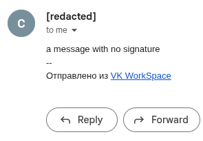
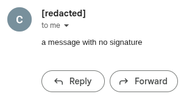

# VK Workspace Signature Cleaner

A Tampermonkey userscript that removes the `Отправлено из VK WorkSpace` ("Sent from VK WorkSpace") footer that VK WorkSpace web mail adds to every message you send.

| Sent from the web version | Sent with this script |
|---|---|
|  |  |

## Why

Since Mail.ru Group renamed itself VK in 2021 and moved Mail.ru for Business into VK WorkSpace, many default settings have changed and more features have moved behind paid plans. One result: the web version of the mail (`https://app.workspace.vk.ru/mail/`) now adds `-- Отправлено из VK WorkSpace` to every message you send or reply to, even below your own signature, and without a paid plan there is no setting to turn it off. You don't see it while writing; it is added when you press Send.

The mobile app doesn't add it, so until now the only way to avoid the footer was to send and reply from your phone. This script removes the hidden footer from messages sent from the web version.

## Install

1. Install [Tampermonkey](https://www.tampermonkey.net/) and allow it to run userscripts in your browser.
2. Open [`vk-workspace-signature-cleaner.user.js`](https://github.com/otanim/userscript-vk-workspace-signature-cleaner/releases/latest/download/vk-workspace-signature-cleaner.user.js) from the latest release and click **Install** in Tampermonkey.
3. Reload the VK WorkSpace mail tab once your draft has saved. The script must load before the mail app starts.

Tampermonkey checks the same link for updates. To build and install from source instead, see [Development](#development).

## How it works

VK WorkSpace shows mail in an embedded `e.mail.ru` frame. When you press Send, the mail app adds the footer to the message after reading the editor, so removing it from the editor has no effect. The script removes it from the outgoing request instead:

- It runs only in the `e.mail.ru` frame embedded in VK WorkSpace, and wraps the browser's XHR and fetch before the mail app loads, using Tampermonkey's [page context](https://www.tampermonkey.net/documentation.php?locale=en&q=sandbox) and [early injection](https://www.tampermonkey.net/documentation.php?locale=en&q=run_at).
- It changes only POST requests to `/api/v1/messages/send` and `/api/v1/messages/schedule` on `https://e.mail.ru`, removing the footer from both the HTML and plain-text versions of the message.
- It recognises the footer by its exact text and its `workspace.vk.ru` link, and removes empty signature blocks next to it.
- Your own signatures, quoted messages, formatting, attachments, recipients, subject and every other request field are left as they are. Drafts are not changed.
- It makes no requests of its own, clicks nothing and stores no message content.

## Checking that it works

Send yourself a test message and check the received email, including its plain-text version if your mail client shows it. In DevTools, select the `e.mail.ru` frame and run:

```js
window[Symbol.for('vk-workspace-signature-cleaner')]
```

It shows the script `version`, `cleanedRequests` and `removedSignatures`. The console also logs a notice each time a footer is removed.

## Limits

- It removes only the footer the mail app adds in the browser. It cannot remove a footer added by the mail server, change messages already sent, or change S/MIME signed or encrypted messages.
- If VK changes the request format, the footer text or its HTML, the footer may come back until the script is updated. Anything the script does not recognise is sent unchanged.
- To turn it off, disable it in Tampermonkey and reload the mail tab.

## Development

Requires Node.js 20.19 or newer.

```bash
npm install
npm test               # behaviour tests with made-up data; nothing is sent
npm run test:scripts   # tests for the install helper
npm run typecheck
npm run build          # writes dist/vk-workspace-signature-cleaner.user.js
npm run build:install  # builds, then opens Tampermonkey's install page for the new build
```

`build:install` serves the built file once from `127.0.0.1` on a random address and opens Tampermonkey's install page; you still confirm the install. Use `npm run build:install -- --skip-build` to install an existing build.

## License

[MIT](./LICENSE)
